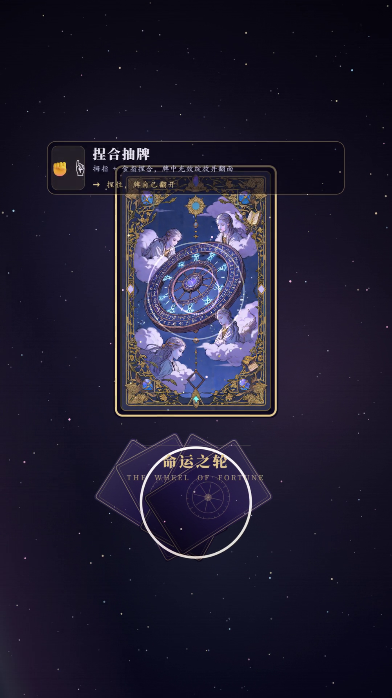

# 🌌 星落掌心 · 用手掌翻牌

> **与霓同梦 · 第二代产品**（手势交互系列 · 手势塔罗）
> 七十八张牌摊在星野里。**你不用碰屏幕**——手掌左右移动，整排牌跟着你滑；食指一指，停在哪张就选中哪张；拇指和食指一捏，牌自己离排、升起、翻过来。



---

## 🎮 在线玩

👉 **https://neon-liyi.github.io/hand-tarot/**

电脑、手机都能开。第一次会问摄像头权限，允许就行。

**不想用摄像头也没关系**：
- 点「**不用摄像头，用鼠标玩**」——鼠标就是手；
- 或者用「**数字抽牌**」：在 1–78 里挑个号码，那就是牌堆里的第几张。

> 摄像头只在**你自己的浏览器里**做识别，**画面不上传、屏幕上也不显示**——屏幕上是星空、牌面和你手的 21 个光点。
> 想亲眼看摄像头画面，按 `V`。

---

## 🖐 手势怎么用

| 手势 | 发生什么 |
|---|---|
| 🖐 **张开手掌左右移动** | 整排牌跟着手掌滑动，快速挥动还带惯性 |
| ☝️ **食指指认** | 选中指向的那张：金色光晕罩住它（牌背朝上时不显示名字，留悬念） |
| 🤏 **拇指＋食指捏合** | 把牌**抽出来**：离排、升起、推近 → 翻面（光爆＋粒子）→ 解读面板浮出 |
| ✊ **握拳约 1.2 秒** | 重新洗牌，把牌收回来 |

**桌面上永远只有一张牌**：抽下一张时，上一张自己滑回牌排并合上；读完点「收好」或按 `Esc` 收牌。

---

## 🔒 隐私

- 摄像头画面**只在本机浏览器内**用于手势识别，**不上传、不保存、不显示**；
- 整个页面是静态文件，没有后端、没有账号、没有埋点；
- 只有一个例外：你按 `V` 时，摄像头画面会**只给你自己看**地显示在屏幕上。

---

## 🚀 本地跑

```bash
# 任意静态服务器都行，比如：
python -m http.server 8123
# 然后打开 http://localhost:8123/
```

⚠️ **不要直接双击 `index.html`**（`file://`）：浏览器会拦掉模块加载，牌一张都不出来；
而且摄像头只在 `http://localhost` 或 `https://` 这类安全地址下可用。

**离线可用**：`vendor/`（MediaPipe 运行时）和 `models/hand_landmarker.task`（手势模型）都随仓库提供，断网也能跑。

---

## 📁 结构

```
星落掌心/
├── index.html          页面与样式
├── app.js              主逻辑（手势管线 / 抽牌动画 / 解读面板）
├── deck.js             78 张牌的数据与牌阵
├── minors.js           小阿卡纳（56 张）
├── meanings*.js        牌义文本
├── reading.js          解读生成
├── spreads.js          牌阵
├── history.js          抽牌记录
├── art.js              牌面绘制
├── assets/cards/*.webp 78 张牌面（WebP）
├── vendor/             MediaPipe Tasks Vision 运行时（含 wasm）
└── models/             hand_landmarker.task 手势模型
```

---

## 🧩 技术

- **MediaPipe Tasks Vision · HandLandmarker**：每帧拿到 21 个手部关键点，在页面里算出「张开 / 指向 / 捏合 / 握拳」；
- **原生 JavaScript + Canvas**：没有框架、没有构建步骤、不用装依赖，`git clone` 完起了静态服务器就能跑；
- **不显示摄像头画面**：视频只作为模型输入，绘图层自己画星空、牌面和手部光点。

---

## 📄 许可

**MIT License** —— 自由使用、修改、分发（含商用），保留版权声明即可。见 [LICENSE](LICENSE)。

## 🙏 第三方资源

| 用到 | 许可 / 说明 |
|---|---|
| [MediaPipe](https://github.com/google-ai-edge/mediapipe) Tasks Vision | Apache-2.0；`vendor/` 下的运行时来自其官方发布 |
| `models/hand_landmarker.task` | 由 MediaPipe 官方提供的手部关键点模型 |
| 78 张牌面、封面、图标 | **本项目自制** |
| 牌义文本 | 本项目整理，公版塔罗释义 |

## 👥 关于与霓同梦

我们做的是让那些**不亮、却一直在的光**被看见的事——用技术去照顾那些没被照顾到的人。
五代产品线：① 情绪烘焙坊 ② **手势交互系列（手势塔罗 / 手势钢琴 / 手势皮影戏）** ③ 月亮夜市 ④ 全息 AI 开发辅助机器人 ⑤ 霓虹系列机器人集群

**蝴蝶飞过霓虹，我们缺几个同梦的人。**
有想法、想一起做，写信到 2954608699@qq.com ／ 2636480069@qq.com

---

与霓同梦
你在，霓就亮。
